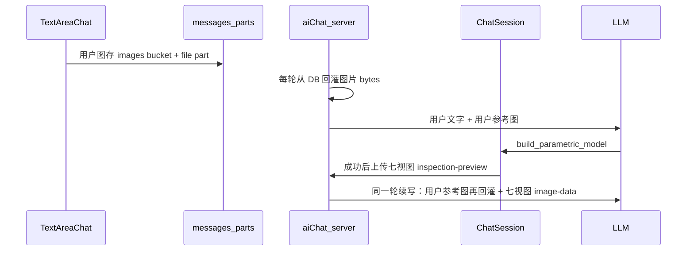

# 待办重排 + 图片输入细化

## 先说清楚：Adam 图片输入到底怎么工作

**不是**「每一轮用算法把七视图和用户图做匹配」。

实际机制：

| 问题                           | 结论                                                                                                          |
| ------------------------------ | ------------------------------------------------------------------------------------------------------------- |
| 每轮迭代还会带上用户上传图吗？ | **会**。每次 tool 续写都会重新从 DB 下载用户 `file` 图片进模型上下文                                          |
| 怎么「校验」？                 | **没有单独匹配工具**。靠视觉模型看图；七视图检查对照的是「用户文字需求」，意图自检是「代码 ↔ 用户文字」      |
| 会不会拿七视图去对用户参考图？ | **原版 parametric 提示词没有明确要求这么做**；creative 路径才强调参考图                                       |
| 当前 SimpleCADAPI 路径缺什么？ | 上传/回灌管道大体还在；缺的是 **parametric 提示词把用户图当视觉真值**，以及工具成功文案提醒「有参考图时对照」 |

因此：实现目标 = **Adam 已验证的图片进模型链路（保留）+ 把 parametric 侧「会看但没被要求用」补成明确规则**。不做图像相似度算法。

---

## 优化后的总待办表（已剔除 #5/#7/#12）

### P0 — 马上做

1. **用户参考图输入（本轮唯一细化项，见下）**
2. 收紧 AI 重试次数（现在约 60 步太松）
3. 跑代码前粗校验（`import` / `result` / 无 markdown fence）
4. 成功后把体积/包围盒塞进 AI 上下文（`inspect_geometry` 进循环）
5. 黄金用例 3～5 条验收（含：带图生成 / 无图生成 / 滑块 / 导出）

### P1 — 随后

6. 加深视觉检查清单（缺件、穿模、比例等；在图片规则之后加）
7. 精简 API 索引（少烧 token；真 RAG 仍后置）
8. 冷启动等待提示（只做 UX 文案，不做 Service Worker）

### P2 — 后置

9. 真 RAG
10. 案例库 / 标准件库
11. 评测仪表盘
12. 高级滑块（表达式局部刷新、装配关节）

**明确不做：** 网格粗细档（#5）、冷启动极致优化（#7）、需求分析对话（#12）。

---

## P0-1 图片输入：要做什么（细化）

### 已有、尽量不动

- 上传 UI：[`TextAreaChat.tsx`](D:\python_project\CADAM\src\components\TextAreaChat.tsx)（粘贴/拖拽/选图；jpeg/png/webp；≥256×256）
- 存储：`images/{userId}/{conversationId}/{imageId}` + message `file` part（[`shared/imageRefs.ts`](D:\python_project\CADAM\shared\imageRefs.ts)）
- 每轮回灌：[`aiChat.ts`](D:\python_project\CADAM\src\server\aiChat.ts) ~1247 下载 bytes → data URL
- 七视图：成功后 `inspection-preview-{toolCallId}` → `toModelOutput` 附给模型
- 模型门槛：`parametricModelSupportsVision`；不支持视觉的模型隐藏图片按钮

### 要改（最小集，对齐「Adam 有效图片辅助」）

1. **改 parametric 系统提示词** — [`src/server/aiChat.ts`](D:\python_project\CADAM\src\server\aiChat.ts) `PARAMETRIC_AGENT_PROMPT_BASE`
   - 增加「若用户消息含参考图」规则：
     - 首轮生成：以参考图的形状/比例/特征布局为视觉依据，文字尺寸约束仍优先
     - 七视图审查：有参考图时，除对照文字需求外，还必须对照用户参考图（轮廓、部件有无、大致比例、朝向）；列出与参考图不一致处再整份重写
     - 意图自检仍保持 **code ↔ 用户文字**；不把「像不像照片」塞进这一步（避免和七视图步骤打架）
   - 明确：参考图是视觉真值，不是装饰；没有参考图时行为与现在一致

2. **对齐工具描述** — [`shared/chatAi.ts`](D:\python_project\CADAM\shared\chatAi.ts) `build_parametric_model` description
   - 写明：有用户参考图时，成功后的七视图必须对照参考图再决定是否 `answer_user`

3. **对齐客户端成功/缺图文案** — [`ChatSession.tsx`](D:\python_project\CADAM\src\components\chat\ChatSession.tsx)
   - 成功消息加上：若对话含用户参考图，审查时一并对照
   - 不改上传/执行主路径

4. **`toModelOutput` 加一句提示** — [`aiChat.ts`](D:\python_project\CADAM\src\server\aiChat.ts)
   - 七视图附上时注明：conversation 中的用户参考图仍在上下文，请与本拼图对照

5. **合同同步** — [`docs/MVP_AGENT_CONTRACT.md`](D:\python_project\CADAM\docs\MVP_AGENT_CONTRACT.md) + SimpleCADAPI 镜像
   - 写清：用户参考图每轮回灌；有图时七视图审查包含「对照参考图」；不做自动图像匹配 API

6. **手工验收**
   - 选支持 vision 的 parametric 模型，上传零件照片 + 短文字 → 首轮是否明显吃图
   - 故意生成不像的结果 → 下一轮是否因参考图+七视图而改
   - 无图对话 → 行为不回归
   - 不支持 vision 的模型 → 图片按钮仍隐藏

### 不在本次做

- 图像相似度 / 特征匹配算法
- 把参考图和七视图拼成一张对比图
- mesh/STL 当参考（parametric 仍按现合同不支持）
- 改上传存储结构或 DB schema
