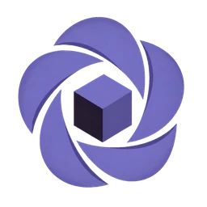
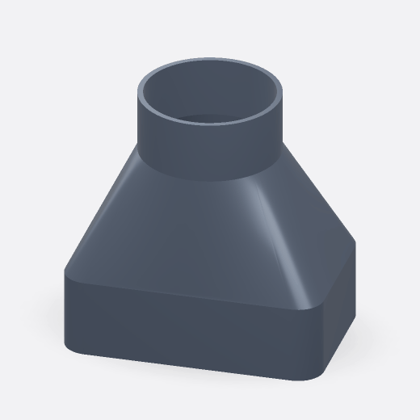
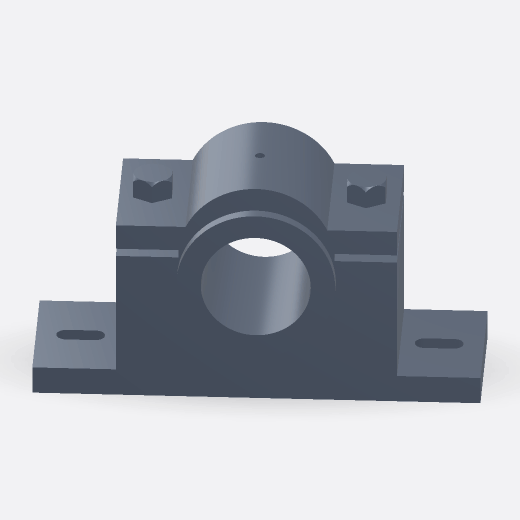
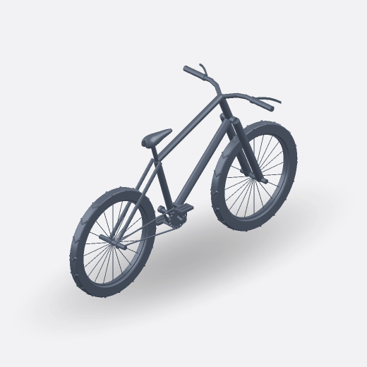
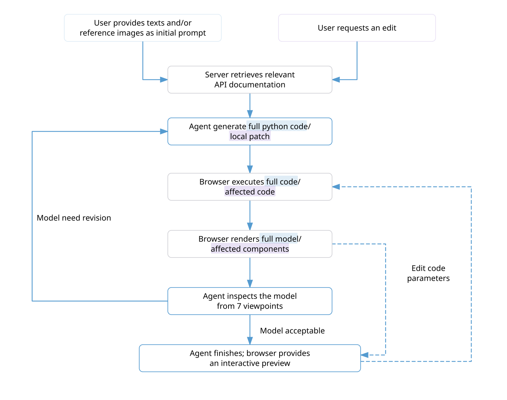

<p align="center">
  
  &nbsp;&nbsp;
  <picture>
    <source media="(prefers-color-scheme: dark)" srcset="public/iris-wordmark-white.svg">
    <source media="(prefers-color-scheme: light)" srcset="public/iris-wordmark-normal@4x.webp">
    
  </picture>
</p>

<h3 align="center">Build parametric CAD assemblies, patch only what changed.</h3>

<p align="center">
  <a href="https://iriscad.com"><strong>Try it now! →</strong></a>
</p>

Iris is an AI CAD agent for building and revising parametric parts and assemblies in the browser.

Describe a model with text or reference images. Iris automatically builds and inspects it, then renders an interactive 3D preview.

Need a local change? Tell Iris what to revise. It patches the affected components and updates the preview without rebuilding the entire assembly.

Export to STEP, STL, or download the generated Python source.

## Examples

<table>
  <thead>
    <tr>
      <th width="18%">Model</th>
      <th width="42%">Prompt</th>
      <th width="40%">Preview</th>
    </tr>
  </thead>
  <tbody>
  <tr>
    <td width="18%"><a href="examples/tapered-perforated-basket.md">Perforated basket</a><br><sub><code>Part</code></sub></td>
    <td width="42%">Model a 300 mm-tall tapered cylindrical wastebasket with a 240 mm top diameter, 200 mm base diameter, 2.5 mm walls, a solid circular base, and a projecting top rim. Pattern 5 rows of evenly spaced 22 &#215; 17 mm rectangular perforations around the upper two-thirds, leaving a solid lower section, and a fillet around the base.</td>
    <td width="40%"></td>
  </tr>
  <tr>
    <td width="18%"><a href="examples/rectangular-to-round-duct-adapter.md">Rectangular-to-round duct adapter</a><br><sub><code>Part</code></sub></td>
    <td width="42%">Create a rectangular-to-round duct adapter with a hollow rounded-rectangular lower section measuring 140 &#215; 90 mm externally, a centered circular upper neck with a 76 mm outer diameter, and a smooth 65 mm-high transition between the two profiles. Keep both ends open with a continuous internal passage and approximately uniform 3 mm wall thickness.</td>
    <td width="40%"></td>
  </tr>
  <tr>
    <td width="18%"><a href="examples/centrifugal-pump-impeller.md">Centrifugal pump impeller</a><br><sub><code>Part</code></sub></td>
    <td width="42%">Create a centrifugal pump impeller with a 90 mm-diameter backplate, a raised 26 mm-diameter hub, a 12 mm through-bore, and 8 evenly spaced, backward-curved blades, each 18 mm high and 3 mm thick, that each sweep a rectangular profile along smooth paths from the hub to the rim.</td>
    <td width="40%"></td>
  </tr>
  <tr>
    <td width="18%"><a href="examples/split-pedestal-bearing.md">Split pedestal bearing</a><br><sub><code>Assembly</code></sub></td>
    <td width="42%">Create a split pedestal bearing assembly with a pedestal on an elongated 220 &#215; 70 mm base featuring two slotted mounting holes and two underside recesses, a removable curved-top cap with a central lubrication hole, and two vertical fasteners with hexagonal tops and rectangular bottom heads. The upper and lower half-bushings are fitted between the pedestal and cap to form a 54 mm-diameter horizontal through-bore.</td>
    <td width="40%"></td>
  </tr>
  <tr>
    <td width="18%"><a href="examples/bike-assembly.md">Bike</a><br><sub><code>Assembly</code></sub></td>
    <td width="42%">Create a mountain bike assembly with a 1300 mm wheelbase, approximately 760 mm-diameter wheels with 20 spokes each and V-shaped tire treads, and a tubular frame. Include a twin-leg front fork, handlebars with separate grips and curved brake levers, a tapered saddle, and a simplified chain drive with a toothed chainring, 170 mm crank arms, and slotted pedals.</td>
    <td width="40%"></td>
  </tr>
  </tbody>
</table>

## IrisCAD Modeling Pipeline



IrisCAD uses SimpleCADAPI to define parametric parts and assemblies in Python, running them in the browser through Pyodide and the OCP.wasm geometry kernel. In a ReAct-style loop, Iris receives execution errors, available geometry measurements, and seven-view previews to check the model against the user’s requirements and reference images. It can then revise the model and continue tool calls automatically, within user-configurable iteration limits.

For assembly edits, IrisCAD uses a routing tool and dependency checks to determine whether a local patch is appropriate. The agent receives editable source sections alongside read-only dependencies as context for patch generation. IrisCAD checks each patch against the current model revision and its dependency impact, reruns the required code sections, and updates affected meshes while reusing unaffected state.

## Highlights

| Feature                   | Description                                             |
| ------------------------- | ------------------------------------------------------- |
| **Text & images**         | Build with a prompt and/or reference image              |
| **Local edits**           | Revise individual parts with targeted patches           |
| **Advanced CAD features** | Build parts with fillets, chamfers, holes, and shelling |
| **Editable parameters**   | Adjust dimensions in the browse and enjoy live preview  |
| **Readable Python**       | Familiar Python code that you can understand and tweak  |
| **Ready to export**       | Download STEP, STL, or PY                               |

## What’s next!

| Direction                   | Description                                              |
| --------------------------- | -------------------------------------------------------- |
| **Selection-based editing** | Select or circle parts to request local changes          |
| **Standard parts library**  | Retrieve and reuse standard CAD components               |
| **Focused inspection**      | Inspect modified parts with surrounding assembly context |
| **CATIA integration**       | Implement a plugin for working with Iris in CATIA        |

## Quick Start

This setup runs IrisCAD with its local SimpleCADAPI fork and hybrid API
retrieval. The two repositories should be cloned into the same parent
directory.

### Prerequisites

- [Git](https://git-scm.com/)
- Node.js `^20.19.0` or `>=22.12.0`, with npm 10 or newer
- [uv](https://docs.astral.sh/uv/)
- [Docker Desktop](https://www.docker.com/products/docker-desktop/) or another
  Docker-compatible container runtime
- An API key for at least one supported AI model provider
- An API key for an OpenAI-compatible embedding endpoint

### 1. Clone and set up

```bash
git clone https://github.com/cath-max/iriscad.git IrisCAD
git clone https://github.com/cath-max/iriscad-simplecadapi.git iriscad-simplecadapi
cd IrisCAD
npm run setup:local
```

`setup:local` installs the JavaScript and Python dependencies, checks the
pinned browser wheels, and creates `.env.local` from `.env.local.template`.
Normal local development uses the wheels already committed to IrisCAD and does
not need to rebuild them.

The resulting directory layout is:

```text
workspace/
├── IrisCAD/
└── iriscad-simplecadapi/
```

### 2. Configure API keys

Open `IrisCAD/.env.local` and replace the placeholders. Configure at least one
supported AI provider, for example Anthropic:

```env
ANTHROPIC_API_KEY="<your Anthropic API key>"
```

Configure the embedding endpoint used by hybrid SimpleCADAPI retrieval. The
following example uses OpenAI directly, but another OpenAI-compatible provider
can be used with its corresponding base URL and model identifier:

```env
EMBEDDING_API_KEY="<your embedding provider API key>"
EMBEDDING_BASE_URL="https://api.openai.com/v1"
EMBEDDING_MODEL="text-embedding-3-small"
```

The checked-in retrieval index uses 1,536-dimensional
`text-embedding-3-small` vectors. A compatible provider must expose that same
embedding model; for example, ZenMux identifies it as
`openai/text-embedding-3-small`.

### 3. Start IrisCAD

Make sure Docker is running, then start the local stack:

```bash
npm run dev:local
```

This command:

- starts or reuses the local Supabase services;
- writes the local Supabase URL and keys to `.env.local`;
- starts the SimpleCADAPI hybrid retrieval sidecar; and
- starts the IrisCAD development server.

Open <http://localhost:3000/>. The first CAD build may take some seconds while
Pyodide and OCP/WASM initialize.

Press `Ctrl+C` to stop IrisCAD and the retrieval sidecar. Supabase remains
running for faster subsequent starts. Stop it separately when needed:

```bash
npx supabase stop
```

### Developing SimpleCADAPI or OCP/WASM

The checked-in browser wheels only need to be rebuilt when changing the CAD
runtime itself:

```bash
npm run setup:wheels -- --simplecadapi-root=../iriscad-simplecadapi
```

## Upstream Projects and Licenses

IrisCAD builds on the work of the following open-source projects. Each project
remains subject to its own license.

| Project                                                   | How IrisCAD uses it                                                                                                                              | License                                                                        |
| --------------------------------------------------------- | ------------------------------------------------------------------------------------------------------------------------------------------------ | ------------------------------------------------------------------------------ |
| [CADAM](https://github.com/Adam-CAD/CADAM)                | IrisCAD is based on and extends CADAM.                                                                                                           | [GPL-3.0](./LICENSE)                                                           |
| [SimpleCADAPI](https://github.com/NiJingzhe/SimpleCADAPI) | IrisCAD uses a [modified distribution](https://github.com/cath-max/iriscad-simplecadapi) for parametric CAD generation and hybrid API retrieval. | [AGPL-3.0](https://github.com/cath-max/iriscad-simplecadapi/blob/main/LICENSE) |
| [OCP.wasm](https://github.com/Yeicor/OCP.wasm)            | IrisCAD distributes the unmodified prebuilt `cadquery-ocp-novtk-OCP.wasm` wheel for browser-native Python code execution.                        | [MIT](https://github.com/Yeicor/OCP.wasm/blob/master/LICENSE)                  |

## Open Source

IrisCAD is open-source software. The IrisCAD application is available under
the GNU GPL v3, while its modified SimpleCADAPI runtime is published separately
under the GNU AGPL v3.

Source code, local setup instructions, upstream attribution, and
[third-party notices](THIRD_PARTY_NOTICES.md) are available in the
[IrisCAD](https://github.com/cath-max/iriscad) and
[SimpleCADAPI](https://github.com/cath-max/iriscad-simplecadapi) repositories.

The hosted service at [iriscad.com](https://iriscad.com) uses external AI and infrastructure providers that are not part of the IrisCAD source distribution.

Maintained by [cath-max](https://github.com/cath-max).
