# Bike

`Assembly`


## Prompt

> Create a mountain bike assembly with a 1300 mm wheelbase, approximately 760 mm-diameter wheels with 20 spokes each and V-shaped tire treads, and a tubular frame. Include a twin-leg front fork, handlebars with separate grips and curved brake levers, a tapered saddle, and a simplified chain drive with a toothed chainring, 170 mm crank arms, and slotted pedals.

## Model source code

[Download Python source](bike-assembly.py)

<details>
<summary>View full Python source</summary>

```python
import simplecadapi as scad

# iriscad:parameters
import math

wheel_outer_radius = 380  # [280:10:420]
wheel_width = 62  # [40:2:80]
rim_outer_radius = 302  # [240:5:350]
rim_radial_thickness = 14  # [8:2:24]
hub_radius = 28  # [18:2:40]
spoke_radius = 2  # [1:0.5:4]
spoke_count = 20  # [12:2:32]
tread_pair_count = 18  # [12:2:28]
tread_arm_length = 44  # [30:2:60]
tread_thickness = 8  # [4:1:12]
tread_v_angle = 38  # [25:1:55]
frame_tube_radius = 23  # [16:1:32]
rear_stay_radius = 12  # [8:1:18]
fork_leg_radius = 27  # [20:1:36]
handlebar_tube_radius = 15  # [10:1:22]
grip_radius = 19  # [14:1:25]
brake_lever_radius = 5  # [3:1:8]
chainring_teeth = 18  # [18:2:36]
chainring_module = 8  # [5:0.5:10]
rear_axle_radius = 16  # [10:1:24]
rear_axle_half_length = 76  # [50:2:100]
chain_tube_radius = 5  # [3:0.5:8]
spindle_radius = 12  # [8:1:20]
spindle_length = 225  # [160:5:280]
pedal_ring_outer_radius = 23  # [20:1:34]
pedal_ring_width = 24  # [16:2:32]
crank_arm_length = 170  # [120:5:220]
pedal_shaft_radius = 9  # [6:1:14]
pedal_body_length = 110  # [80:5:140]
pedal_body_width = 70  # [50:2:90]
pedal_body_thickness = 22  # [14:2:30]
saddle_rear_radius = 45  # [34:1:56]
saddle_mid_radius = 32  # [24:1:42]
saddle_nose_radius = 18  # [12:1:26]
saddle_notch_radius = 9  # [6:1:14]
grip_length = 170
grip_inner_radius = 15
grip_hole_diameter = 3
grip_hole_count = 3
grip_hole_offset = 7
horizontal_bar_retain = 0.6
rear_axle = (-650.0, 0.0, 360.0)
front_axle = (650.0, 0.0, 360.0)
bottom_bracket = (-105.0, 0.0, 360.0)
seat_cluster = (-245.0, 0.0, 810.0)
head_lower = (425.0, 0.0, 870.0)
steering_top = (312.0, 0.0, 1060.0)
sprocket_plane_y = -50
saddle_x_shift = 105
saddle_tilt_deg = 5

# iriscad:helper tube_between
def tube_between(start, end, radius):
    dx = end[0] - start[0]
    dy = end[1] - start[1]
    dz = end[2] - start[2]
    length = math.sqrt(dx * dx + dy * dy + dz * dz)
    return scad.make_cylinder_rsolid(radius, length, bottom_face_center=start, axis=(dx / length, dy / length, dz / length))

# iriscad:helper annulus_y
def annulus_y(outer_radius, inner_radius, width, center=(0.0, 0.0, 0.0)):
    outer = scad.make_cylinder_rsolid(outer_radius, width, bottom_face_center=(center[0], center[1] - width / 2.0, center[2]), axis=(0.0, 1.0, 0.0))
    inner = scad.make_cylinder_rsolid(inner_radius, width + 4.0, bottom_face_center=(center[0], center[1] - width / 2.0 - 2.0, center[2]), axis=(0.0, 1.0, 0.0))
    return scad.cut_rsolid(outer, inner)

# iriscad:helper make_two_layer_wheel_with_treads
def make_two_layer_wheel_with_treads():
    inner_ring = annulus_y(rim_outer_radius, rim_outer_radius - rim_radial_thickness, 24.0)
    outer_ring_raw = annulus_y(wheel_outer_radius - 8.0, rim_outer_radius - 5.0, wheel_width)
    outer_ring = scad.fillet_rsolid(outer_ring_raw, outer_ring_raw.get_edges(), 8.0)
    hub = scad.make_cylinder_rsolid(hub_radius, 76.0, bottom_face_center=(0.0, -38.0, 0.0), axis=(0.0, 1.0, 0.0))
    wheel_solids = [inner_ring, outer_ring, hub]
    spoke_end_radius = rim_outer_radius - rim_radial_thickness / 2.0
    for index in range(spoke_count):
        angle = 2.0 * math.pi * index / spoke_count
        wheel_solids.append(tube_between((0.0, 0.0, 0.0), (spoke_end_radius * math.cos(angle), 0.0, spoke_end_radius * math.sin(angle)), spoke_radius))
    alpha = math.radians(tread_v_angle)
    tread_surface_radius = wheel_outer_radius - 12.0
    for index in range(tread_pair_count):
        theta = 2.0 * math.pi * index / tread_pair_count
        radial = (math.cos(theta), 0.0, math.sin(theta))
        tangent = (-math.sin(theta), 0.0, math.cos(theta))
        common = (tread_surface_radius * radial[0], 0.0, tread_surface_radius * radial[2])
        for side_sign in (-1.0, 1.0):
            direction = (-math.cos(alpha) * tangent[0], side_sign * math.sin(alpha), -math.cos(alpha) * tangent[2])
            end = (common[0] + direction[0] * tread_arm_length, common[1] + direction[1] * tread_arm_length, common[2] + direction[2] * tread_arm_length)
            wheel_solids.append(tube_between(common, end, tread_thickness))
    return scad.union_rsolid(wheel_solids, glue=False)

# iriscad:helper make_pedal
def make_pedal(side_sign):
    ring_center_y = side_sign * 100.0
    ring = annulus_y(pedal_ring_outer_radius, spindle_radius + 0.5, pedal_ring_width, (bottom_bracket[0], ring_center_y, bottom_bracket[2]))
    hole_bottom_z = bottom_bracket[2] + (20.0 if side_sign > 0 else -32.0)
    wall_hole = scad.make_cylinder_rsolid(4.0, 12.0, bottom_face_center=(bottom_bracket[0], ring_center_y, hole_bottom_z), axis=(0.0, 0.0, 1.0))
    ring = scad.cut_rsolid(ring, wall_hole)
    arm_direction = (0.5 * side_sign, 0.0, -0.8660254 * side_sign)
    arm_profile = scad.make_rectangle_rface(20.0, 12.0, center=(bottom_bracket[0], ring_center_y, bottom_bracket[2]), normal=arm_direction)
    arm = scad.extrude_rsolid(arm_profile, arm_direction, crank_arm_length)
    arm = scad.chamfer_rsolid(arm, arm.get_edges(), 1.5)
    arm_end = (bottom_bracket[0] + arm_direction[0] * crank_arm_length, ring_center_y, bottom_bracket[2] + arm_direction[2] * crank_arm_length)
    joint = scad.make_cylinder_rsolid(10.0, 16.0, bottom_face_center=(arm_end[0], ring_center_y - 8.0, arm_end[2]), axis=(0.0, 1.0, 0.0))
    shaft_length = 60.0
    shaft = scad.make_cylinder_rsolid(pedal_shaft_radius, shaft_length, bottom_face_center=(arm_end[0], ring_center_y, arm_end[2]), axis=(0.0, side_sign, 0.0))
    body_center_y = ring_center_y + side_sign * (shaft_length + pedal_body_width / 2.0)
    body = scad.make_box_rsolid(pedal_body_length, pedal_body_width, pedal_body_thickness, bottom_face_center=(arm_end[0], body_center_y, arm_end[2] - pedal_body_thickness / 2.0))
    body = scad.fillet_rsolid(body, body.get_edges(), 4.0)
    through_depth = pedal_body_thickness + 4.0
    through_bottom_z = arm_end[2] - pedal_body_thickness / 2.0 - 2.0
    slot_a = scad.make_box_rsolid(80.0, 8.0, through_depth, bottom_face_center=(arm_end[0], body_center_y - 14.0, through_bottom_z))
    slot_b = scad.make_box_rsolid(80.0, 8.0, through_depth, bottom_face_center=(arm_end[0], body_center_y + 14.0, through_bottom_z))
    body = scad.cut_rsolid(body, slot_a, slot_b)
    return scad.union_rsolid(ring, arm, joint, shaft, body, glue=False)

# iriscad:helper chain_point
def chain_point(center, radius, angle_deg):
    a = math.radians(angle_deg)
    return (center[0] + radius * math.cos(a), sprocket_plane_y, center[2] + radius * math.sin(a))

# iriscad:helper make_hollow_grip
def make_hollow_grip():
    outer = scad.make_cylinder_rsolid(grip_radius, grip_length, bottom_face_center=(0.0, 0.0, 0.0), axis=(0.0, 1.0, 0.0))
    bore = scad.make_cylinder_rsolid(grip_inner_radius, grip_length + 4.0, bottom_face_center=(0.0, -2.0, 0.0), axis=(0.0, 1.0, 0.0))
    grip_body = scad.cut_rsolid(outer, bore)
    hole_radius = grip_hole_diameter / 2.0
    hole_tools = []
    for index in range(grip_hole_count):
        phi = 2.0 * math.pi * index / grip_hole_count
        radial = (math.cos(phi), 0.0, math.sin(phi))
        span = grip_radius + 4.0
        start = (-radial[0] * span, grip_hole_offset, -radial[2] * span)
        hole_tools.append(scad.make_cylinder_rsolid(hole_radius, 2.0 * span, bottom_face_center=start, axis=radial))
    return scad.cut_rsolid(grip_body, hole_tools)

# iriscad:helper make_capped_hollow_grip
def make_capped_hollow_grip():
    grip_body = make_hollow_grip()
    end_cap_thickness = 6.0
    end_cap = scad.make_cylinder_rsolid(grip_radius, end_cap_thickness, bottom_face_center=(0.0, grip_length - end_cap_thickness, 0.0), axis=(0.0, 1.0, 0.0))
    return scad.union_rsolid(grip_body, end_cap, glue=False)

# iriscad:helper make_brake_control
def make_brake_control():
    collar_width = 18.0
    collar = annulus_y(22.0, handlebar_tube_radius, collar_width, center=(0.0, -collar_width / 2.0, 0.0))
    neck = scad.make_box_rsolid(30.0, 14.0, 16.0, bottom_face_center=(-15.0, -9.0, -20.0))
    neck = scad.fillet_rsolid(neck, neck.get_edges(), 2.5)
    blade_profiles = [
        scad.make_rectangle_rwire(14.0, 8.0, center=(-28.0, -9.0, -12.0), normal=(1.0, 0.0, 0.0)),
        scad.make_rectangle_rwire(13.0, 7.0, center=(-45.0, -15.0, -18.0), normal=(1.0, 0.0, 0.0)),
        scad.make_rectangle_rwire(11.0, 6.0, center=(-85.0, -23.0, -24.0), normal=(1.0, 0.0, 0.0)),
        scad.make_rectangle_rwire(9.0, 5.0, center=(-130.0, -30.0, -22.0), normal=(1.0, 0.0, 0.0)),
        scad.make_rectangle_rwire(7.0, 4.5, center=(-165.0, -33.0, -13.0), normal=(1.0, 0.0, 0.0)),
        scad.make_circle_rwire((-183.0, -27.0, -3.0), 3.5, normal=(1.0, 0.0, 0.0)),
    ]
    blade = scad.loft_rsolid(blade_profiles, ruled=False)
    return scad.union_rsolid(collar, neck, blade, glue=False)

# iriscad:part wheel_part
wheel_inner_ring = annulus_y(rim_outer_radius, rim_outer_radius - rim_radial_thickness, 24.0)
wheel_outer_ring_raw = annulus_y(wheel_outer_radius - 8.0, rim_outer_radius - 5.0, wheel_width)
wheel_outer_ring = scad.fillet_rsolid(wheel_outer_ring_raw, wheel_outer_ring_raw.get_edges(), 8.0)
wheel_center_bar = scad.make_cylinder_rsolid(16.0, 228.0, bottom_face_center=(0.0, -114.0, 0.0), axis=(0.0, 1.0, 0.0))
wheel_solids = [wheel_inner_ring, wheel_outer_ring, wheel_center_bar]
spoke_end_radius = rim_outer_radius - rim_radial_thickness / 2.0
for index in range(spoke_count):
    angle = 2.0 * math.pi * index / spoke_count
    wheel_solids.append(tube_between((0.0, 0.0, 0.0), (spoke_end_radius * math.cos(angle), 0.0, spoke_end_radius * math.sin(angle)), spoke_radius))
alpha = math.radians(tread_v_angle)
tread_surface_radius = wheel_outer_radius - 12.0
for index in range(tread_pair_count):
    theta = 2.0 * math.pi * index / tread_pair_count
    radial = (math.cos(theta), 0.0, math.sin(theta))
    tangent = (-math.sin(theta), 0.0, math.cos(theta))
    common = (tread_surface_radius * radial[0], 0.0, tread_surface_radius * radial[2])
    for side_sign in (-1.0, 1.0):
        direction = (-math.cos(alpha) * tangent[0], side_sign * math.sin(alpha), -math.cos(alpha) * tangent[2])
        end = (common[0] + direction[0] * tread_arm_length, common[1] + direction[1] * tread_arm_length, common[2] + direction[2] * tread_arm_length)
        wheel_solids.append(tube_between(common, end, tread_thickness))
wheel_body = scad.union_rsolid(wheel_solids, glue=False)
wheel_part = scad.make_part_rpart("wheel_part", wheel_body, name="Wheel")
# iriscad:part main_frame_part
fork_slope = (360.0 - 870.0) / (650.0 - 425.0)
steering_top = (head_lower[0] + (steering_top[2] - head_lower[2]) / fork_slope, 0.0, steering_top[2])
main_frame_body = scad.union_rsolid(tube_between(seat_cluster, steering_top, frame_tube_radius), tube_between(head_lower, bottom_bracket, frame_tube_radius + 5.0), tube_between(bottom_bracket, seat_cluster, frame_tube_radius), tube_between(head_lower, steering_top, frame_tube_radius + 3.0), glue=False)
main_frame_part = scad.make_part_rpart("main_frame_part", main_frame_body, name="Main frame")

# iriscad:part left_rear_stay_part
left_rear_stay_part = scad.make_part_rpart("left_rear_stay_part", tube_between((rear_axle[0], -34.0, rear_axle[2]), (seat_cluster[0], -34.0, seat_cluster[2]), rear_stay_radius), name="Left rear stay")

# iriscad:part right_rear_stay_part
right_rear_stay_part = scad.make_part_rpart("right_rear_stay_part", tube_between((rear_axle[0], 34.0, rear_axle[2]), (seat_cluster[0], 34.0, seat_cluster[2]), rear_stay_radius), name="Right rear stay")

# iriscad:part fork_part
fork_left_top = (425.0, -55.0, 870.0)
fork_right_top = (425.0, 55.0, 870.0)
fork_body = scad.union_rsolid(tube_between(fork_left_top, (650.0, -55.0, 360.0), fork_leg_radius), tube_between(fork_right_top, (650.0, 55.0, 360.0), fork_leg_radius), tube_between(fork_left_top, fork_right_top, 24.0), tube_between((650.0, -70.0, 360.0), (650.0, 70.0, 360.0), 18.0), glue=False)
fork_part = scad.make_part_rpart("fork_part", fork_body, name="Front fork")

# iriscad:part handlebar_part
frame_rack_slope = (steering_top[2] - seat_cluster[2]) / (steering_top[0] - seat_cluster[0])
grip_positions = {}
handlebar_solids = []
for side_sign in (-1.0, 1.0):
    first_bend = (400.0, side_sign * 95.0, steering_top[2] + frame_rack_slope * (400.0 - steering_top[0]))
    old_second_bend = (480.0, side_sign * 441.0, steering_top[2] + frame_rack_slope * (480.0 - steering_top[0]))
    second_bend = (first_bend[0] + 0.2 * (old_second_bend[0] - first_bend[0]), first_bend[1] + 0.2 * (old_second_bend[1] - first_bend[1]), first_bend[2] + 0.2 * (old_second_bend[2] - first_bend[2]))
    third_start = (second_bend[0], second_bend[1] - side_sign * 10.0, second_bend[2])
    orig_tube_end = (second_bend[0], second_bend[1] + side_sign * 155.0, second_bend[2])
    orig_grip_end = (second_bend[0], orig_tube_end[1] + side_sign * 55.0, second_bend[2])
    grip_end = (third_start[0] + horizontal_bar_retain * (orig_grip_end[0] - third_start[0]), third_start[1] + horizontal_bar_retain * (orig_grip_end[1] - third_start[1]), third_start[2] + horizontal_bar_retain * (orig_grip_end[2] - third_start[2]))
    removed_len = (1.0 - horizontal_bar_retain) * (orig_grip_end[1] - third_start[1])
    shift = (0.0, -removed_len, 0.0)
    tube_end = (orig_tube_end[0] + shift[0], orig_tube_end[1] + shift[1], orig_tube_end[2] + shift[2])
    handlebar_solids.append(tube_between(steering_top, first_bend, handlebar_tube_radius))
    handlebar_solids.append(tube_between(first_bend, second_bend, handlebar_tube_radius))
    handlebar_solids.append(tube_between(third_start, grip_end, handlebar_tube_radius))
    grip_positions[side_sign] = {"tube_end": tube_end, "second_bend": second_bend}
handlebar_part = scad.make_part_rpart("handlebar_part", scad.union_rsolid(handlebar_solids, glue=False), name="Handlebar")

# iriscad:part grip_part
grip_part = scad.make_part_rpart("grip_part", make_capped_hollow_grip(), name="Grip")

# iriscad:part brake_control_part
collar_width = 18.0
brake_collar = annulus_y(22.0, handlebar_tube_radius, collar_width, center=(0.0, -collar_width / 2.0, 0.0))
brake_anchor = (22.0, -collar_width / 2.0, 0.0)
mount_turn = math.radians(102.5)
mount_cos = math.cos(mount_turn)
mount_sin = math.sin(mount_turn)
lever_turn = math.radians(42.5)
lever_cos = math.cos(lever_turn)
lever_sin = math.sin(lever_turn)
mount_axis = (mount_cos, mount_sin, 0.0)
lever_axis = (lever_cos, lever_sin, 0.0)
brake_root_start = (brake_anchor[0] - mount_cos, brake_anchor[1] - mount_sin, brake_anchor[2])
brake_root_mount = scad.make_cylinder_rsolid(brake_lever_radius, 9.0, bottom_face_center=brake_root_start, axis=mount_axis)
source_blade_points = [
    (22.0, -9.0, 0.0),
    (42.0, -5.0, -5.0),
    (78.0, 5.0, -11.0),
    (118.0, 17.0, -12.0),
    (153.0, 30.0, -7.0),
    (178.0, 40.0, 0.0),
    (190.0, 44.0, 3.0),
]
brake_blade_centers = []
for point in source_blade_points:
    dx = point[0] - brake_anchor[0]
    dy = point[1] - brake_anchor[1]
    brake_blade_centers.append((brake_anchor[0] + lever_cos * dx - lever_sin * dy, brake_anchor[1] + lever_sin * dx + lever_cos * dy, point[2]))
brake_blade_profiles = [scad.make_rectangle_rwire(8.0, 14.0, center=center, normal=lever_axis) for center in brake_blade_centers]
brake_blade = scad.loft_rsolid(brake_blade_profiles, ruled=True)
brake_control_body = scad.union_rsolid(brake_collar, brake_root_mount, brake_blade, glue=False)
brake_control_part = scad.make_part_rpart("brake_control_part", brake_control_body, name="Left brake lever")

# iriscad:part brake_control_part_right_brake_control
right_brake_blade = scad.mirror_shape(brake_blade, plane_origin=(0.0, 0.0, 0.0), plane_normal=(0.0, 0.0, 1.0))
right_brake_control_body = scad.union_rsolid(brake_collar, brake_root_mount, right_brake_blade, glue=False)
brake_control_part_right_brake_control = scad.make_part_rpart("brake_control_part_right_brake_control", right_brake_control_body, name="Right brake lever")

# iriscad:part seatpost_part
seat_tube_slope = (seat_cluster[2] - bottom_bracket[2]) / (seat_cluster[0] - bottom_bracket[0])
seatpost_top = (seat_cluster[0] + (955.0 - seat_cluster[2]) / seat_tube_slope, 0.0, 955.0)
seatpost_part = scad.make_part_rpart("seatpost_part", tube_between(seat_cluster, seatpost_top, 15.0), name="Seatpost")

# iriscad:part saddle_part
saddle_z_shift = -20.0
saddle_sections = [scad.make_circle_rwire((-462.0, 0.0, 990.0 + saddle_z_shift), saddle_rear_radius * 2.0 / 3.0, normal=(1.0, 0.0, 0.0)), scad.make_circle_rwire((-435.0, 0.0, 990.0 + saddle_z_shift), saddle_rear_radius, normal=(1.0, 0.0, 0.0)), scad.make_circle_rwire((-330.0, 0.0, 995.0 + saddle_z_shift), saddle_mid_radius, normal=(1.0, 0.0, 0.0)), scad.make_circle_rwire((-245.0, 0.0, 992.0 + saddle_z_shift), saddle_nose_radius, normal=(1.0, 0.0, 0.0)), scad.make_circle_rwire((-215.0, 0.0, 990.0 + saddle_z_shift), saddle_nose_radius * 0.55, normal=(1.0, 0.0, 0.0))]
saddle_solid = scad.loft_rsolid(saddle_sections, ruled=False)
bottom_trim = scad.make_box_rsolid(420.0, 200.0, 60.0, bottom_face_center=(-340.0, 0.0, 915.0 + saddle_z_shift))
saddle_solid = scad.cut_rsolid(saddle_solid, bottom_trim)
bottom_rim_edges = [e for e in saddle_solid.get_edges() if abs(e.get_center().z - (975.0 + saddle_z_shift)) < 1.5]
if bottom_rim_edges:
    saddle_solid = scad.fillet_rsolid(saddle_solid, bottom_rim_edges, 2.0)
rear_notch = scad.make_cylinder_rsolid(saddle_notch_radius, 110.0, bottom_face_center=(-462.0, 0.0, 935.0 + saddle_z_shift), axis=(0.0, 0.0, 1.0))
saddle_solid = scad.cut_rsolid(saddle_solid, rear_notch)
saddle_part = scad.make_part_rpart("saddle_part", saddle_solid, name="Saddle")

# iriscad:part chainring_gear_part
chainring_gear_body = scad.std.gear.make_spur_gear_rsolid(n_teeth=chainring_teeth, module=chainring_module, pressure_angle=20.0, gear_height=12.0)
chainring_gear_part = scad.make_part_rpart("chainring_gear_part", chainring_gear_body, name="Chainring")

# iriscad:part crank_spindle_part
spindle_body = scad.make_cylinder_rsolid(spindle_radius, spindle_length, bottom_face_center=(bottom_bracket[0], -spindle_length / 2.0, bottom_bracket[2]), axis=(0.0, 1.0, 0.0))
crank_spindle_part = scad.make_part_rpart("crank_spindle_part", spindle_body, name="Crank spindle")

# iriscad:part right_pedal_part
right_pedal_part = scad.make_part_rpart("right_pedal_part", make_pedal(1.0), name="Right crank and pedal")

# iriscad:part left_pedal_part
left_pedal_part = scad.make_part_rpart("left_pedal_part", make_pedal(-1.0), name="Left crank and pedal")

# iriscad:part chain_part
front_wrap_radius = chainring_module * chainring_teeth / 2.0 + 10.0
rear_wrap_radius = rear_axle_radius + 6.0
center_distance = bottom_bracket[0] - rear_axle[0]
normal_x = (front_wrap_radius - rear_wrap_radius) / center_distance
tangency_angle = math.degrees(math.atan2(math.sqrt(1.0 - normal_x * normal_x), normal_x))
chain_solids = []
front_arc_points = [chain_point(bottom_bracket, front_wrap_radius, tangency_angle - 2.0 * tangency_angle * index / 12.0) for index in range(13)]
rear_arc_points = [chain_point(rear_axle, rear_wrap_radius, tangency_angle + (360.0 - 2.0 * tangency_angle) * index / 14.0) for index in range(15)]
for index in range(len(front_arc_points) - 1):
    chain_solids.append(tube_between(front_arc_points[index], front_arc_points[index + 1], chain_tube_radius))
for index in range(len(rear_arc_points) - 1):
    chain_solids.append(tube_between(rear_arc_points[index], rear_arc_points[index + 1], chain_tube_radius))
chain_solids.append(tube_between(front_arc_points[0], rear_arc_points[0], chain_tube_radius))
chain_solids.append(tube_between(front_arc_points[-1], rear_arc_points[-1], chain_tube_radius))
chain_part = scad.make_part_rpart("chain_part", scad.union_rsolid(chain_solids, glue=False), name="Chain")

# iriscad:assembly_setup
assembly = scad.make_assembly_rassembly("mountain_bike_assembly", name="Mountain bike")

# iriscad:component rear_wheel
assembly = scad.add_component_rassembly(assembly, wheel_part, "rear_wheel", scad.make_placement_rplacement(rear_axle), name="Rear wheel")

# iriscad:component front_wheel
assembly = scad.add_component_rassembly(assembly, wheel_part, "front_wheel", scad.make_placement_rplacement(front_axle), name="Front wheel")

# iriscad:component main_frame
assembly = scad.add_component_rassembly(assembly, main_frame_part, "main_frame", scad.identity_placement_rplacement(), name="Main frame")

# iriscad:component left_rear_stay
assembly = scad.add_component_rassembly(assembly, left_rear_stay_part, "left_rear_stay", scad.identity_placement_rplacement(), name="Left rear stay")

# iriscad:component right_rear_stay
assembly = scad.add_component_rassembly(assembly, right_rear_stay_part, "right_rear_stay", scad.identity_placement_rplacement(), name="Right rear stay")

# iriscad:component suspension_fork
assembly = scad.add_component_rassembly(assembly, fork_part, "suspension_fork", scad.identity_placement_rplacement(), name="Front fork")

# iriscad:component handlebar
assembly = scad.add_component_rassembly(assembly, handlebar_part, "handlebar", scad.identity_placement_rplacement(), name="Handlebar")

# iriscad:component left_grip
left_grip_tube_end = grip_positions[-1.0]["tube_end"]
left_grip_placement = scad.make_placement_rplacement(left_grip_tube_end, x_axis=(1.0, 0.0, 0.0), y_axis=(0.0, -1.0, 0.0))
assembly = scad.add_component_rassembly(assembly, grip_part, "left_grip", left_grip_placement, name="Left grip")

# iriscad:component right_grip
right_grip_tube_end = grip_positions[1.0]["tube_end"]
right_grip_placement = scad.make_placement_rplacement(right_grip_tube_end, x_axis=(1.0, 0.0, 0.0), y_axis=(0.0, 1.0, 0.0))
assembly = scad.add_component_rassembly(assembly, grip_part, "right_grip", right_grip_placement, name="Right grip")

# iriscad:component left_brake_control
left_brake_placement = scad.make_placement_rplacement(left_grip_tube_end, x_axis=(1.0, 0.0, 0.0), y_axis=(0.0, -1.0, 0.0))
assembly = scad.add_component_rassembly(assembly, brake_control_part, "left_brake_control", left_brake_placement, name="Left brake lever")

# iriscad:component right_brake_control
right_brake_placement = scad.make_placement_rplacement(right_grip_tube_end, x_axis=(1.0, 0.0, 0.0), y_axis=(0.0, 1.0, 0.0))
assembly = scad.add_component_rassembly(assembly, brake_control_part_right_brake_control, "right_brake_control", right_brake_placement, name="Right brake lever")

# iriscad:component seatpost
assembly = scad.add_component_rassembly(assembly, seatpost_part, "seatpost", scad.identity_placement_rplacement(), name="Seatpost")

# iriscad:component saddle
contact_local = (seatpost_top[0] - saddle_x_shift, 0.0, seatpost_top[2])
tilt = math.radians(saddle_tilt_deg)
cos_t = math.cos(tilt)
sin_t = math.sin(tilt)
rx = (cos_t, 0.0, sin_t)
rz = (-sin_t, 0.0, cos_t)
new_origin = (saddle_x_shift + contact_local[0] - (rx[0] * contact_local[0] + rz[0] * contact_local[2]), 0.0, contact_local[2] - (rx[2] * contact_local[0] + rz[2] * contact_local[2]))
saddle_placement = scad.make_placement_rplacement(new_origin, x_axis=(cos_t, 0.0, sin_t), y_axis=(0.0, 1.0, 0.0))
assembly = scad.add_component_rassembly(assembly, saddle_part, "saddle", saddle_placement, name="Saddle")

# iriscad:component chainring_gear
gear_placement = scad.make_placement_rplacement((bottom_bracket[0], sprocket_plane_y - 6.0, bottom_bracket[2]), x_axis=(1.0, 0.0, 0.0), y_axis=(0.0, 0.0, -1.0))
assembly = scad.add_component_rassembly(assembly, chainring_gear_part, "chainring_gear", gear_placement, name="Chainring")

# iriscad:component crank_spindle
assembly = scad.add_component_rassembly(assembly, crank_spindle_part, "crank_spindle", scad.identity_placement_rplacement(), name="Crank spindle")

# iriscad:component right_pedal
assembly = scad.add_component_rassembly(assembly, right_pedal_part, "right_pedal", scad.identity_placement_rplacement(), name="Right crank and pedal")

# iriscad:component left_pedal
assembly = scad.add_component_rassembly(assembly, left_pedal_part, "left_pedal", scad.identity_placement_rplacement(), name="Left crank and pedal")

# iriscad:component drive_chain
assembly = scad.add_component_rassembly(assembly, chain_part, "drive_chain", scad.identity_placement_rplacement(), name="Chain")

# iriscad:assembly_result
result = assembly
```

</details>

## Key editable parameters

| Variable                | Value | Range     | Description                                                 |
| ----------------------- | ----- | --------- | ----------------------------------------------------------- |
| `wheel_outer_radius`    | `380` | `280–420` | Outer radius of wheel                                       |
| `wheel_width`           | `62`  | `40–80`   | Tire body width                                             |
| `spoke_count`           | `20`  | `12–32`   | Number of spokes per wheel                                  |
| `tread_pair_count`      | `18`  | `12–28`   | Number of V-shaped tread pairs per wheel                    |
| `tread_v_angle`         | `38`  | `25–55`   | Angle of each tread arm from the wheel tangent (in degrees) |
| `frame_tube_radius`     | `23`  | `16–32`   | Base radius used for the main frame tubes                   |
| `rear_stay_radius`      | `12`  | `8–18`    | Radius of the rear stay tubes                               |
| `fork_leg_radius`       | `27`  | `20–36`   | Radius of each front fork leg                               |
| `handlebar_tube_radius` | `15`  | `10–22`   | Radius of the handlebar tubes                               |
| `grip_radius`           | `19`  | `14–25`   | Outer radius of each grip                                   |
| `chainring_teeth`       | `18`  | `18–36`   | Number of teeth on the simplified gear-based chainring      |
| `crank_arm_length`      | `170` | `120–220` | Length of each crank arm                                    |
| `pedal_body_length`     | `110` | `80–140`  | Length of each pedal platform                               |
| `pedal_body_width`      | `70`  | `50–90`   | Width of each pedal platform                                |
| `saddle_rear_radius`    | `45`  | `34–56`   | Radius of the widest rear saddle profile                    |
| `saddle_tilt_deg`       | `5`   |           | Saddle tilt angle in degrees                                |

Dimensions are in millimeters unless noted; counts are unitless.

## Components

<table>
  <tr><th scope="row">Rear wheel / Front wheel</th><td>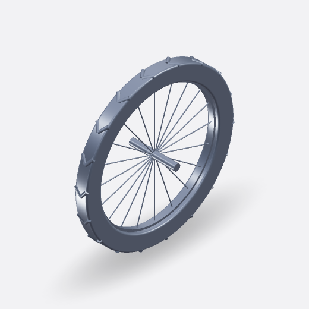</td></tr>
  <tr><th scope="row">Main frame</th><td>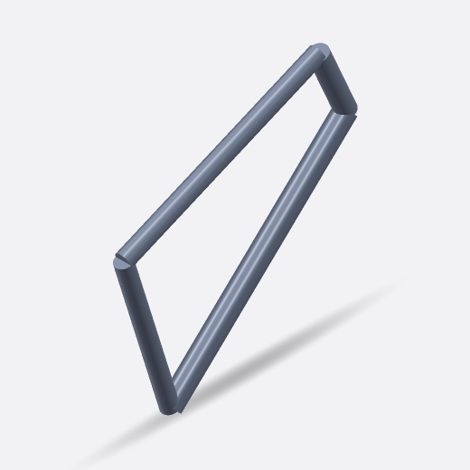</td></tr>
  <tr><th scope="row">Left rear stay / Right rear stay</th><td>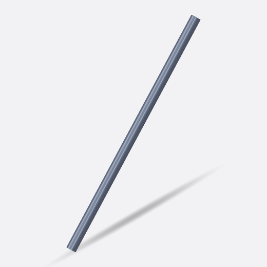</td></tr>
  <tr><th scope="row">Front fork</th><td>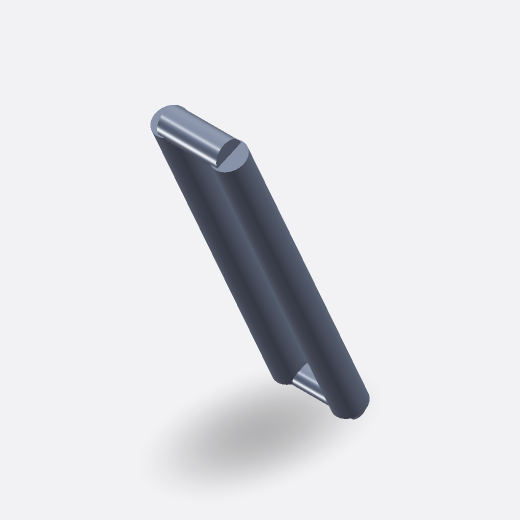</td></tr>
  <tr><th scope="row">Handlebar</th><td>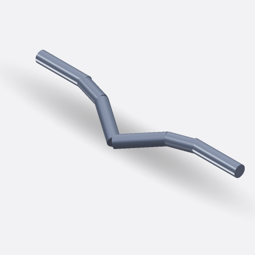</td></tr>
  <tr><th scope="row">Left grip / Right grip</th><td>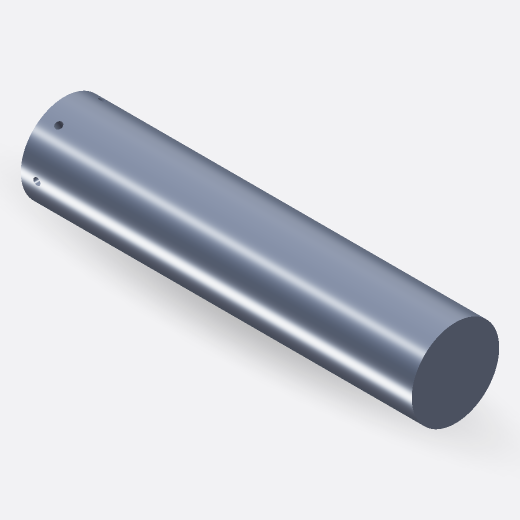</td></tr>
  <tr><th scope="row">Left brake lever / Right brake lever</th><td>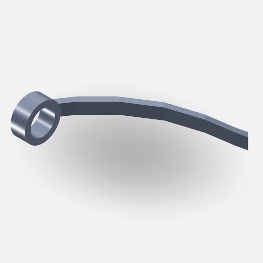</td></tr>
  <tr><th scope="row">Seatpost</th><td>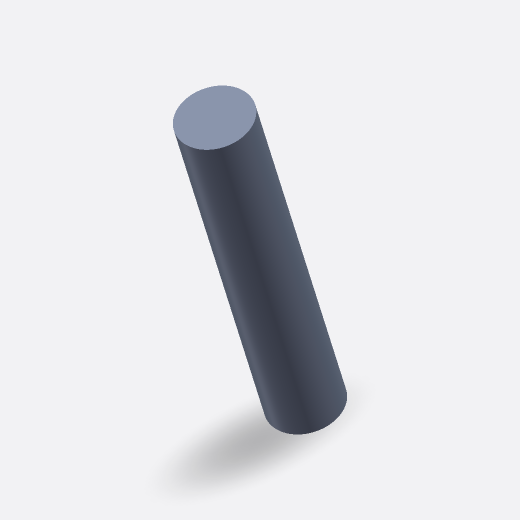</td></tr>
  <tr><th scope="row">Saddle</th><td>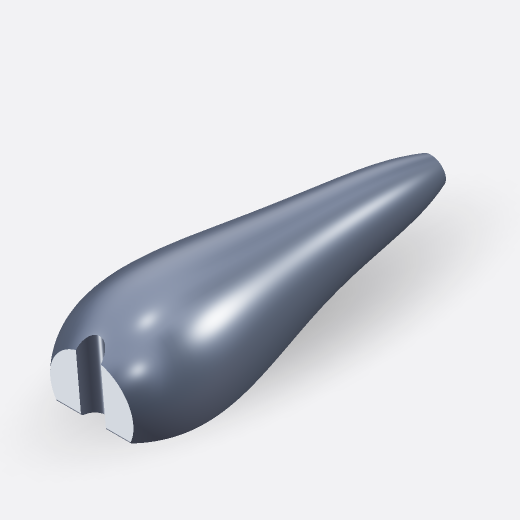</td></tr>
  <tr><th scope="row">Chainring</th><td>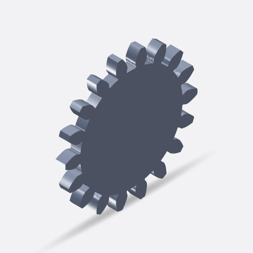</td></tr>
  <tr><th scope="row">Crank spindle</th><td>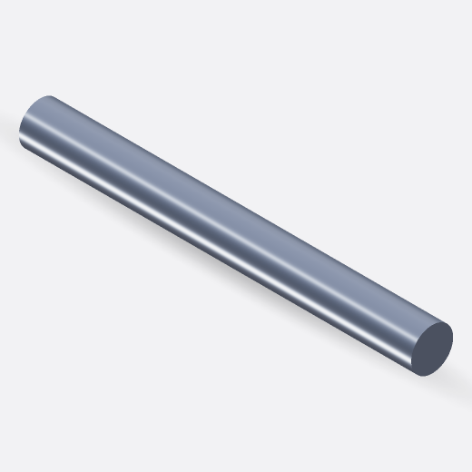</td></tr>
  <tr><th scope="row">Left crank and pedal / Right crank and pedal</th><td>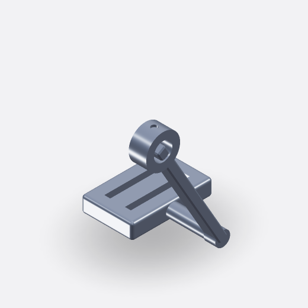</td></tr>
  <tr><th scope="row">Chain</th><td>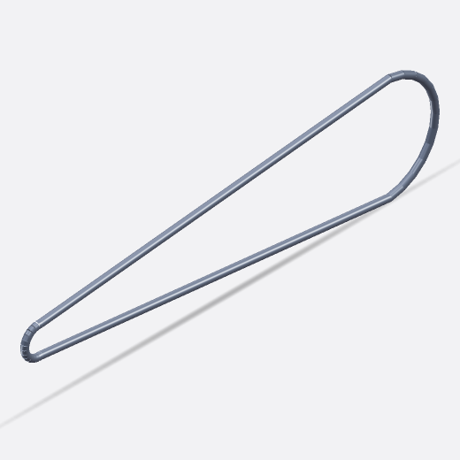</td></tr>
</table>

## Model highlights

- Uses `make_part_rpart` and `add_component_rassembly` to build a detailed, visually cohesive bike assembly;
- Uses `make_placement_rplacement` to tilt the saddle around its seatpost connection point;
- Applies `loft_rsolid` to shape the saddle and curved brake levers from multiple profiles;
- Uses `mirror_shape` to create the opposite brake lever without redefining its profile geometry;
- Uses `std.gear.make_spur_gear_rsolid` to generate the simplified chainring from tooth-count and module parameters.
