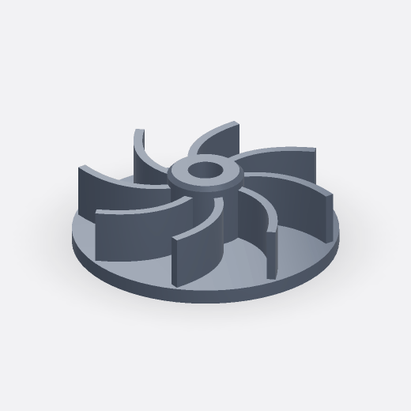

# Centrifugal pump impeller

`Part`



## Prompt

> Create a centrifugal pump impeller with a 90 mm-diameter backplate, a raised 26 mm-diameter hub, a 12 mm through-bore, and 8 evenly spaced, backward-curved blades, each 18 mm high and 3 mm thick, that each sweep a rectangular profile along smooth paths from the hub to the rim.

## Model source code

[Download Python source](centrifugal-pump-impeller.py)

<details>
<summary>View full Python source</summary>

```python
import simplecadapi as scad

backplate_diameter = 90  # [60:2:140]
backplate_thickness = 5  # [3:0.5:10]
hub_outer_diameter = 26  # [18:1:40]
hub_total_height = 27  # [10:1:30]
hub_chamfer_size = 1.5  # [0.5:0.5:3]
through_bore_diameter = 12  # [6:1:20]
blade_count = 8  # [4:1:10]
blade_height = 18  # [5:1:20]
blade_thickness = 3  # [2:0.5:6]
blade_root_radius = 12  # [9:1:18]
blade_tip_radius = 43  # [30:1:44]
blade_sweep_angle = 34  # [15:1:55]

backplate_radius = backplate_diameter / 2.0
hub_outer_radius = hub_outer_diameter / 2.0
through_bore_radius = through_bore_diameter / 2.0
blade_mid_height = backplate_thickness + blade_height / 2.0

backplate = scad.make_cylinder_rsolid(
    backplate_radius,
    backplate_thickness,
    bottom_face_center=(0.0, 0.0, 0.0),
)

hub = scad.make_cylinder_rsolid(
    hub_outer_radius,
    hub_total_height,
    bottom_face_center=(0.0, 0.0, 0.0),
)
hub = scad.apply_tag(hub, "role.hub_chamfer_edges")
hub_edges = scad.select_edges_by_tag(hub, "role.hub_chamfer_edges")
hub = scad.chamfer_rsolid(hub, hub_edges, hub_chamfer_size)

blade_path_edge = scad.make_spline_redge(
    control_points=[
        (blade_root_radius, 0.0, blade_mid_height),
        (21.0, -1.5, blade_mid_height),
        (31.0, -7.0, blade_mid_height),
        (blade_tip_radius * 0.829, -blade_tip_radius * 0.559, blade_mid_height),
    ],
    degree=3,
)
blade_path = scad.make_wire_from_edges_rwire([blade_path_edge])

blade_profile = scad.make_rectangle_rface(
    blade_thickness,
    blade_height,
    center=(blade_root_radius, 0.0, blade_mid_height),
    normal=(1.0, -0.15, 0.0),
)
seed_blade = scad.sweep_rsolid(blade_profile, blade_path, is_frenet=False)

blades = scad.radial_pattern_rsolidlist(
    seed_blade,
    center=(0.0, 0.0, 0.0),
    axis=(0.0, 0.0, 1.0),
    count=blade_count,
    total_rotation_angle=360.0,
)

impeller_blank = scad.union_rsolid(backplate, hub, blades, glue=False)

bore_tool = scad.make_cylinder_rsolid(
    through_bore_radius,
    hub_total_height + 2.0,
    bottom_face_center=(0.0, 0.0, -1.0),
)

result = scad.cut_rsolid(impeller_blank, bore_tool)
```

</details>

## Key editable parameters

| Variable                | Value | Range    | Description                                 |
| ----------------------- | ----- | -------- | ------------------------------------------- |
| `backplate_diameter`    | `90`  | `60–140` | Outer diameter of the backplate             |
| `backplate_thickness`   | `5`   | `3–10`   | Thickness of the backplate                  |
| `hub_outer_diameter`    | `26`  | `18–40`  | Outer diameter of the hub before chamfering |
| `through_bore_diameter` | `12`  | `6–20`   | Diameter of the central through-bore        |
| `blade_count`           | `8`   | `4–10`   | Number of blades                            |
| `blade_height`          | `18`  | `5–20`   | Height of each blade above the backplate    |
| `blade_thickness`       | `3`   | `2–6`    | Thickness of the rectangular blade profile  |

Dimensions are in millimeters.

## Model highlights

- Uses `sweep_rsolid` to form a curved blade from a rectangular profile and a spline path;
- Applies `radial_pattern_rsolidlist` to repeat the blade evenly around the hub;
- Combines `select_edges_by_tag` with `chamfer_rsolid` to chamfer the tagged hub edges.
