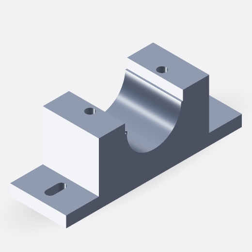
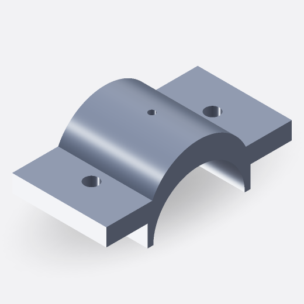
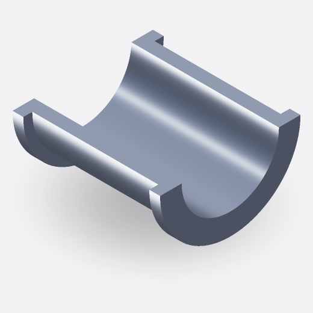
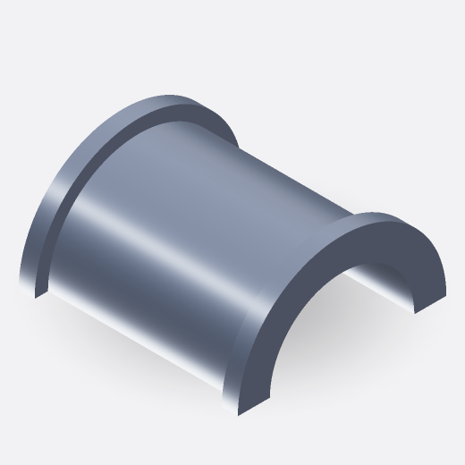
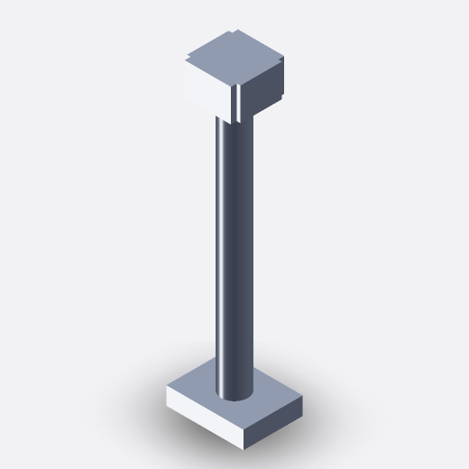
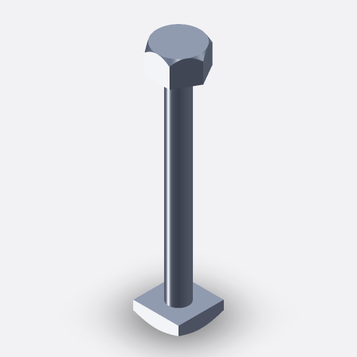
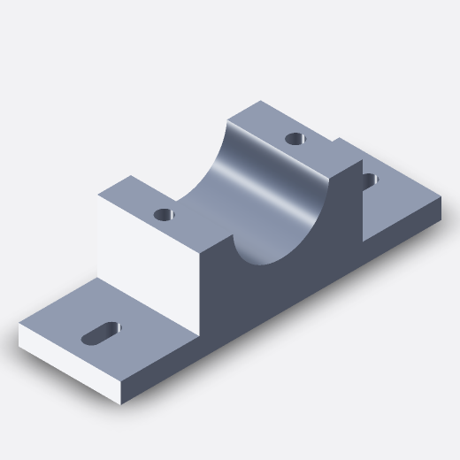
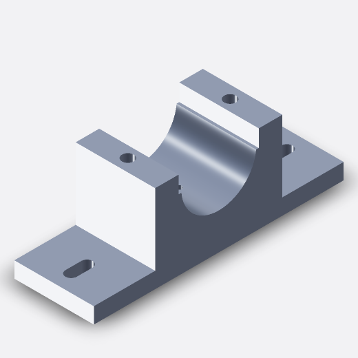

# Split pedestal bearing

`Assembly`


## Prompt

> Create a split pedestal bearing assembly with a pedestal on an elongated 220 × 70 mm base featuring two slotted mounting holes and two underside recesses, a removable curved-top cap with a central lubrication hole, and two vertical fasteners with hexagonal tops and rectangular bottom heads. The upper and lower half-bushings are fitted between the pedestal and cap to form a 54 mm-diameter horizontal through-bore.

## Model source code

[Download Python source](split-pedestal-bearing.py)

<details>
<summary>View full Python source</summary>

```python
import simplecadapi as scad

# iriscad:parameters
base_length = 220  # [160:10:300]
base_width = 70  # [50:5:100]
base_thickness = 14  # [8:1:24]
housing_width = 138  # [90:2:150]
split_height = 65  # [50:2:90]
cap_ear_top_height = 94  # [85:1:110]
cap_ear_bottom_height = 81  # [78:1:93]
bore_diameter = 54  # [30:2:70]
bushing_outer_diameter = 68  # [46:2:90]
flange_outer_diameter = 78  # [58:2:105]
housing_length_y = 70  # [50:5:100]
bushing_barrel_length = 82  # [60:2:100]
flange_thickness = 6  # [3:1:12]
mounting_slot_length = 24  # [16:2:40]
mounting_slot_width = 10  # [6:1:16]
mounting_slot_spacing = 176  # [130:4:230]
fastener_spacing = 90  # [65:5:120]
fastener_shank_diameter = 9  # [6:1:14]
lubrication_hole_diameter = 5  # [3:1:10]
pocket_width = 20  # [20:2:40]
pocket_length_y = 20  # [28:2:52]
pocket_depth = 8  # [5:1:12]

bore_radius = bore_diameter / 2.0
bushing_outer_radius = bushing_outer_diameter / 2.0
flange_outer_radius = flange_outer_diameter / 2.0
slot_radius = mounting_slot_width / 2.0
slot_center_offset = (mounting_slot_length - mounting_slot_width) / 2.0
cap_top_height = cap_ear_top_height
fastener_x = fastener_spacing / 2.0

# Internal cutter allowances: expression assignments stay out of the parameter panel.
cutter_overrun = (2.0)
fastener_hole_radial_clearance = (0.7)
fastener_hole_radius = fastener_shank_diameter / 2.0 + fastener_hole_radial_clearance
housing_cut_length_y = housing_length_y + 2.0 * cutter_overrun
housing_cut_start_y = -housing_length_y / 2.0 - cutter_overrun

# iriscad:part base_part
base_plate = scad.make_box_rsolid(base_length, base_width, base_thickness, bottom_face_center=(0.0, 0.0, 0.0))
wall_height_above_groove = 12
raised_shoulder_top = split_height + wall_height_above_groove
raised_housing_height = raised_shoulder_top - base_thickness
lower_housing = scad.make_box_rsolid(housing_width, housing_length_y, raised_housing_height, bottom_face_center=(0.0, 0.0, base_thickness))
base_blank = scad.union_rsolid(base_plate, lower_housing, glue=False)
seat_clearance_radius = bushing_outer_radius
bore_tool_lower = scad.make_cylinder_rsolid(seat_clearance_radius, housing_cut_length_y, bottom_face_center=(0.0, housing_cut_start_y, split_height), axis=(0.0, 1.0, 0.0))
u_wall_depth = (4)  # Internal constant; not a user parameter.
u_wall_bottom = split_height - u_wall_depth
u_wall_half_width = (seat_clearance_radius * seat_clearance_radius - u_wall_depth * u_wall_depth) ** 0.5
u_wall_opening = scad.make_box_rsolid(2.0 * u_wall_half_width, housing_cut_length_y, raised_shoulder_top - u_wall_bottom + 2.0, bottom_face_center=(0.0, 0.0, u_wall_bottom))
base_bored = scad.cut_rsolid(base_blank, bore_tool_lower, u_wall_opening)
locating_groove_depth = (2)  # Internal constant; not a user parameter.
rebate_floor_z = split_height
upward_open_rebate_tools = []
for wall_sign in (-1.0, 1.0):
    rebate_x = wall_sign * (u_wall_half_width + locating_groove_depth / 2.0)
    upward_open_rebate_tools.append(scad.make_box_rsolid(locating_groove_depth + 1.0, housing_cut_length_y, raised_shoulder_top - rebate_floor_z + 2.0, bottom_face_center=(rebate_x, 0.0, rebate_floor_z)))
base_grooved = scad.cut_rsolid(base_bored, upward_open_rebate_tools)
seat_hole_diameter = 5
seat_hole_depth = 8
seat_lowest_z = split_height - seat_clearance_radius
seat_hole_tool = scad.make_cylinder_rsolid(seat_hole_diameter / 2.0, seat_hole_depth + 1.0, bottom_face_center=(0.0, 0.0, seat_lowest_z - seat_hole_depth), axis=(0.0, 0.0, 1.0))
base_with_seat_hole = scad.cut_rsolid(base_grooved, seat_hole_tool)
slot_tools = []
for slot_x in (-mounting_slot_spacing / 2.0, mounting_slot_spacing / 2.0):
    slot_cylinder_a = scad.make_cylinder_rsolid(slot_radius, base_thickness + 4.0, bottom_face_center=(slot_x - slot_center_offset, 0.0, -2.0))
    slot_cylinder_b = scad.make_cylinder_rsolid(slot_radius, base_thickness + 4.0, bottom_face_center=(slot_x + slot_center_offset, 0.0, -2.0))
    slot_bridge = scad.make_box_rsolid(mounting_slot_length - mounting_slot_width, mounting_slot_width, base_thickness + 4.0, bottom_face_center=(slot_x, 0.0, -2.0))
    slot_tools.extend([slot_cylinder_a, slot_cylinder_b, slot_bridge])
base_slotted = scad.cut_rsolid(base_with_seat_hole, slot_tools)
pocket_tools = []
bolt_hole_tools = []
for bolt_x in (-fastener_x, fastener_x):
    pocket_tools.append(scad.make_box_rsolid(pocket_width, pocket_length_y, pocket_depth + 1.0, bottom_face_center=(bolt_x, 0.0, -1.0)))
    bolt_hole_tools.append(scad.make_cylinder_rsolid(fastener_hole_radius, raised_shoulder_top + 3.0, bottom_face_center=(bolt_x, 0.0, -1.0)))
base_solid = scad.cut_rsolid(base_slotted, pocket_tools, bolt_hole_tools)
base_part = scad.make_part_rpart("base_part", base_solid, name="Elongated lower pedestal and U-seat base")

# iriscad:part cap_part
cap_insert_half_width = u_wall_half_width
cap_rebate_tab_bottom_z = split_height
cap_rebate_tab_top_z = cap_ear_bottom_height
cap_rebate_tab_height = cap_rebate_tab_top_z - cap_rebate_tab_bottom_z
pedestal_rebate_outer_x = u_wall_half_width + locating_groove_depth + 0.5
cap_leg_outer_x = pedestal_rebate_outer_x + locating_groove_depth
cap_ear_outer_x = housing_width / 2.0
cap_prismatic_full = scad.make_box_rsolid(housing_width, housing_length_y, cap_top_height - split_height, bottom_face_center=(0.0, 0.0, split_height))
cap_side_relief_width = cap_ear_outer_x - cap_leg_outer_x
cap_side_relief_center_x = (cap_leg_outer_x + cap_ear_outer_x) / 2.0
cap_left_side_relief = scad.make_box_rsolid(cap_side_relief_width, housing_cut_length_y, cap_rebate_tab_height, bottom_face_center=(-cap_side_relief_center_x, 0.0, cap_rebate_tab_bottom_z))
cap_right_side_relief = scad.make_box_rsolid(cap_side_relief_width, housing_cut_length_y, cap_rebate_tab_height, bottom_face_center=(cap_side_relief_center_x, 0.0, cap_rebate_tab_bottom_z))
cap_prismatic = scad.cut_rsolid(cap_prismatic_full, cap_left_side_relief, cap_right_side_relief)
cap_crown_apex_height = 116
cap_crown_rise = cap_crown_apex_height - cap_top_height
# Preserve the existing crown silhouette independently of the seat fit.
cap_crown_half_width = ((bushing_outer_radius + 1.0) ** 2 - 4.0 ** 2) ** 0.5
cap_crown_radius = (cap_crown_half_width ** 2 + cap_crown_rise ** 2) / (2.0 * cap_crown_rise)
cap_crown_axis_height = cap_crown_apex_height - cap_crown_radius
cap_crown_full = scad.make_cylinder_rsolid(cap_crown_radius, housing_length_y, bottom_face_center=(0.0, -housing_length_y / 2.0, cap_crown_axis_height), axis=(0.0, 1.0, 0.0))
cap_crown_trim = scad.make_box_rsolid(180.0, 100.0, cap_top_height, bottom_face_center=(0.0, 0.0, 0.0))
cap_crown = scad.cut_rsolid(cap_crown_full, cap_crown_trim)
cap_blank = scad.union_rsolid(cap_prismatic, cap_crown, glue=False)
cap_bore_tool = scad.make_cylinder_rsolid(bushing_outer_radius, housing_cut_length_y, bottom_face_center=(0.0, housing_cut_start_y, split_height), axis=(0.0, 1.0, 0.0))
cap_tools = [cap_bore_tool]
for bolt_x in (-fastener_x, fastener_x):
    cap_tools.append(scad.make_cylinder_rsolid(fastener_hole_radius, 55.0, bottom_face_center=(bolt_x, 0.0, cap_ear_bottom_height - cutter_overrun)))
lube_tool = scad.make_cylinder_rsolid(lubrication_hole_diameter / 2.0, 80.0, bottom_face_center=(0.0, 0.0, split_height))
cap_tools.append(lube_tool)
cap_solid = scad.cut_rsolid(cap_blank, cap_tools)
cap_part = scad.make_part_rpart("cap_part", cap_solid, name="Curved removable bearing cap")
# iriscad:part lower_bushing_part
barrel_outer = scad.make_cylinder_rsolid(bushing_outer_radius, bushing_barrel_length, bottom_face_center=(0.0, -bushing_barrel_length / 2.0, split_height), axis=(0.0, 1.0, 0.0))
front_flange_outer = scad.make_cylinder_rsolid(flange_outer_radius, flange_thickness, bottom_face_center=(0.0, -bushing_barrel_length / 2.0, split_height), axis=(0.0, 1.0, 0.0))
back_flange_outer = scad.make_cylinder_rsolid(flange_outer_radius, flange_thickness, bottom_face_center=(0.0, bushing_barrel_length / 2.0 - flange_thickness, split_height), axis=(0.0, 1.0, 0.0))
bushing_outer = scad.union_rsolid(barrel_outer, front_flange_outer, back_flange_outer, glue=False)
bushing_bore_tool = scad.make_cylinder_rsolid(bore_radius, bushing_barrel_length + 4.0, bottom_face_center=(0.0, -bushing_barrel_length / 2.0 - 2.0, split_height), axis=(0.0, 1.0, 0.0))
full_bushing = scad.cut_rsolid(bushing_outer, bushing_bore_tool)
upper_removal = scad.make_box_rsolid(120.0, 120.0, 100.0, bottom_face_center=(0.0, 0.0, split_height))
lower_bushing_half = scad.cut_rsolid(full_bushing, upper_removal)
locating_pin_overlap = (2)  # Internal constant; not a user parameter.
locating_pin_bottom_z = seat_lowest_z - seat_hole_depth
locating_pin_height = seat_hole_depth + locating_pin_overlap
locating_pin = scad.make_cylinder_rsolid(seat_hole_diameter / 2.0, locating_pin_height, bottom_face_center=(0.0, 0.0, locating_pin_bottom_z), axis=(0.0, 0.0, 1.0))
lower_bushing_solid = scad.union_rsolid(lower_bushing_half, locating_pin, glue=False)
lower_bushing_part = scad.make_part_rpart("lower_bushing_part", lower_bushing_solid, name="Lower flanged half-bushing")

# iriscad:part upper_bushing_part
lower_removal = scad.make_box_rsolid(120.0, 120.0, split_height + 100.0, bottom_face_center=(0.0, 0.0, -100.0))
upper_bushing_solid = scad.cut_rsolid(full_bushing, lower_removal)
upper_bushing_part = scad.make_part_rpart("upper_bushing_part", upper_bushing_solid, name="Upper flanged half-bushing")

# iriscad:part fastener_part
fastener_shank = scad.make_cylinder_rsolid(fastener_shank_diameter / 2.0, 96.0, bottom_face_center=(0.0, 0.0, 5.0))
bottom_head_side = 20
bottom_head_bottom = (0)  # Internal constant; not a user parameter.
bottom_head_thickness = 6
bottom_square_prism = scad.make_box_rsolid(bottom_head_side, bottom_head_side, bottom_head_thickness, bottom_face_center=(0.0, 0.0, bottom_head_bottom))
bottom_chamfer_height = 2
bottom_head_apothem = bottom_head_side / 2.0
bottom_head_circumradius = 1.4142135624 * bottom_head_apothem
bottom_revolve_profile = scad.make_rectangle_rwire(6.0, bottom_chamfer_height, center=(bottom_head_apothem + 3.0, 0.0, bottom_head_bottom + bottom_chamfer_height / 2.0), normal=(0.0, 1.0, 0.0))
bottom_revolved_outer_band = scad.revolve_rsolid(bottom_revolve_profile, axis=(0.0, 0.0, 1.0), angle=360.0, origin=(0.0, 0.0, 0.0))
bottom_chamfer_limit_cone = scad.make_cone_rsolid(bottom_head_apothem, bottom_chamfer_height, top_radius=bottom_head_circumradius, bottom_face_center=(0.0, 0.0, bottom_head_bottom), axis=(0.0, 0.0, 1.0))
bottom_revolved_chamfer_cut = scad.cut_rsolid(bottom_revolved_outer_band, bottom_chamfer_limit_cone)
chamfered_bottom_square_head = scad.cut_rsolid(bottom_square_prism, bottom_revolved_chamfer_cut)
hex_apothem = 9.5
hex_head_bottom = cap_ear_top_height
hex_head_height = 11
hex_head_center_z = hex_head_bottom + hex_head_height / 2.0
hex_slab_length = (30)  # Internal constant; not a user parameter.
hex_profile_0 = scad.make_rectangle_rwire(hex_slab_length, hex_head_height, center=(-hex_apothem, 0.0, hex_head_center_z), normal=(1.0, 0.0, 0.0))
hex_slab_0 = scad.extrude_rsolid(hex_profile_0, direction=(1.0, 0.0, 0.0), distance=2.0 * hex_apothem)
hex_profile_60 = scad.make_rectangle_rwire(hex_slab_length, hex_head_height, center=(0.5 * hex_apothem, -0.8660254038 * hex_apothem, hex_head_center_z), normal=(-0.5, 0.8660254038, 0.0))
hex_slab_60 = scad.extrude_rsolid(hex_profile_60, direction=(-0.5, 0.8660254038, 0.0), distance=2.0 * hex_apothem)
hex_profile_120 = scad.make_rectangle_rwire(hex_slab_length, hex_head_height, center=(0.5 * hex_apothem, 0.8660254038 * hex_apothem, hex_head_center_z), normal=(-0.5, -0.8660254038, 0.0))
hex_slab_120 = scad.extrude_rsolid(hex_profile_120, direction=(-0.5, -0.8660254038, 0.0), distance=2.0 * hex_apothem)
regular_hex_head = scad.intersect_rsolid(hex_slab_0, hex_slab_60, hex_slab_120)
chamfer_height = 2.2
chamfer_bottom = hex_head_bottom + hex_head_height - chamfer_height
hex_circumradius = hex_apothem / 0.8660254038
revolve_profile = scad.make_rectangle_rwire(4.8, chamfer_height, center=(hex_apothem + 2.4, 0.0, chamfer_bottom + chamfer_height / 2.0), normal=(0.0, 1.0, 0.0))
revolved_outer_band = scad.revolve_rsolid(revolve_profile, axis=(0.0, 0.0, 1.0), angle=360.0, origin=(0.0, 0.0, 0.0))
chamfer_limit_cone = scad.make_cone_rsolid(hex_circumradius, chamfer_height, top_radius=hex_apothem, bottom_face_center=(0.0, 0.0, chamfer_bottom), axis=(0.0, 0.0, 1.0))
revolved_chamfer_cut = scad.cut_rsolid(revolved_outer_band, chamfer_limit_cone)
chamfered_hex_head = scad.cut_rsolid(regular_hex_head, revolved_chamfer_cut)
fastener_solid = scad.union_rsolid(fastener_shank, chamfered_bottom_square_head, chamfered_hex_head, glue=False)
fastener_part = scad.make_part_rpart("fastener_part", fastener_solid, name="Vertical clamping fastener")

# iriscad:assembly_setup
assembly = scad.make_assembly_rassembly("split_pedestal_bearing", name="Split Pedestal Bearing Assembly")

# iriscad:component base_component
base_placement = scad.identity_placement_rplacement()
assembly = scad.add_component_rassembly(assembly, base_part, "base_component", base_placement, name="Lower base")

# iriscad:component cap_component
cap_placement = scad.identity_placement_rplacement()
assembly = scad.add_component_rassembly(assembly, cap_part, "cap_component", cap_placement, name="Removable curved cap")

# iriscad:component lower_bushing_component
lower_bushing_placement = scad.identity_placement_rplacement()
assembly = scad.add_component_rassembly(assembly, lower_bushing_part, "lower_bushing_component", lower_bushing_placement, name="Lower half-bushing")

# iriscad:component upper_bushing_component
upper_bushing_placement = scad.identity_placement_rplacement()
assembly = scad.add_component_rassembly(assembly, upper_bushing_part, "upper_bushing_component", upper_bushing_placement, name="Upper half-bushing")

# iriscad:component left_fastener_component
left_fastener_placement = scad.make_placement_rplacement((-fastener_x, 0.0, 0.0))
assembly = scad.add_component_rassembly(assembly, fastener_part, "left_fastener_component", left_fastener_placement, name="Left vertical fastener")

# iriscad:component right_fastener_component
right_fastener_placement = scad.make_placement_rplacement((fastener_x, 0.0, 0.0))
assembly = scad.add_component_rassembly(assembly, fastener_part, "right_fastener_component", right_fastener_placement, name="Right vertical fastener")

# iriscad:assembly_result
result = assembly
```

</details>

## Key editable parameters

| Variable                    | Value | Range     | Description                                       |
| --------------------------- | ----- | --------- | ------------------------------------------------- |
| `base_length`               | `220` | `160–300` | Overall base length                               |
| `base_width`                | `70`  | `50–100`  | Overall base width                                |
| `base_thickness`            | `14`  | `8–24`    | Base plate thickness                              |
| `housing_width`             | `138` | `90–150`  | Width of the pedestal housing                     |
| `housing_length_y`          | `70`  | `50–100`  | Housing length along the bore axis                |
| `split_height`              | `65`  | `50–90`   | Height of the bore center and bushing split plane |
| `bore_diameter`             | `54`  | `30–70`   | Diameter of the horizontal through-bore           |
| `bushing_outer_diameter`    | `68`  | `46–90`   | Outer diameter of the bushing barrel              |
| `bushing_barrel_length`     | `82`  | `60–100`  | Total axial length of the bushing                 |
| `flange_outer_diameter`     | `78`  | `58–105`  | Outer diameter of the bushing flanges             |
| `mounting_slot_length`      | `24`  | `16–40`   | Overall length of each mounting slot              |
| `mounting_slot_width`       | `10`  | `6–16`    | Width of each mounting slot                       |
| `mounting_slot_spacing`     | `176` | `130–230` | Center spacing of the mounting slots              |
| `fastener_spacing`          | `90`  | `65–120`  | Distance between the two fasteners                |
| `fastener_shank_diameter`   | `9`   | `6–14`    | Diameter of each fastener shank                   |
| `lubrication_hole_diameter` | `5`   | `3–10`    | Diameter of the cap's lubrication hole            |

Dimensions are in millimeters.

## Components

<table>
  <tr><th scope="row">Lower base</th><td></td></tr>
  <tr><th scope="row">Removable curved cap</th><td></td></tr>
  <tr><th scope="row">Lower half-bushing</th><td></td></tr>
  <tr><th scope="row">Upper half-bushing</th><td></td></tr>
  <tr><th scope="row">Left vertical fastener / Right vertical fastener</th><td></td></tr>
</table>

## Refinement

The assembly was finalized through multiple local patches on individual part(s); two of them are shown below, along with prompt abstract and comparison of affected part included.

### Fastener heads

> Revise the fasteners with hexagonal top heads and square bottom heads, each chamfered to a flat circular end face.

Updated components: **Left vertical fastener** and **Right vertical fastener**

<table>
  <tr><th>Before</th><th>After</th></tr>
  <tr>
    <td></td>
    <td></td>
  </tr>
</table>

### Pedestal seat

> Modify the lower pedestal by adding a small hole at the seat’s lowest center and raising its shoulders with upward-open L-shaped ledges aligned with the lower half-bushing’s split edges.

Updated component: **Lower base**

<table>
  <tr><th>Before</th><th>After</th></tr>
  <tr>
    <td></td>
    <td></td>
  </tr>
</table>

## Model highlights

- Uses `make_part_rpart` and `add_component_rassembly` to organize separate parts with respect to real-life assemble;
- Uses `revolve_rsolid`, `make_cone_rsolid`, and `cut_rsolid` to shape the head chamfers with circular end faces;
- Shares axis-height and radius parameters across `make_cylinder_rsolid` and `cut_rsolid` calls to coordinate the pedestal seat, cap bore, and half-bushings.
