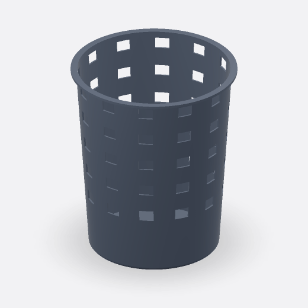

# Perforated basket

`Part`



## Prompt

> Model a 300 mm-tall tapered cylindrical wastebasket with a 240 mm top diameter, 200 mm base diameter, 2.5 mm walls, a solid circular base, and a projecting top rim. Pattern 5 rows of evenly spaced 22 × 17 mm rectangular perforations around the upper two-thirds, leaving a solid lower section, and a fillet around the base.

## Model source code

[Download Python source](tapered-perforated-basket.py)

<details>
<summary>View full Python source</summary>

```python
import simplecadapi as scad

# Overall dimensions
basket_height = 300  # [200:10:500]
top_diameter = 240  # [160:10:320]
base_diameter = 200  # [140:10:280]
wall_thickness = 2.5  # [1.5:0.5:5]
base_thickness = 6  # [3:1:12]
base_fillet_radius = 6  # [2:1:10]

# Top reinforcing rim
rim_projection = 8  # [3:1:15]
rim_height = 4  # [2:1:8]

# Rectangular ventilation pattern
perforation_width = 22  # [10:1:28]
perforation_height = 17  # [8:1:24]
perforation_rows = 5
perforations_per_row = 12
solid_lower_height = 90  # [60:5:140]
perforation_top_margin = 10  # [5:1:20]

base_radius = base_diameter / 2.0
top_radius = top_diameter / 2.0
inner_base_radius = base_radius + (top_radius - base_radius) * (base_thickness / basket_height) - wall_thickness
inner_top_radius = top_radius - wall_thickness

outer_body = scad.make_cone_rsolid(
    base_radius,
    basket_height,
    top_radius=top_radius,
    bottom_face_center=(0.0, 0.0, 0.0),
)

bottom_edges = [
    edge for edge in outer_body.get_edges()
    if abs(edge.get_center().z) < 0.01
]
outer_body = scad.fillet_rsolid(
    outer_body,
    bottom_edges,
    base_fillet_radius,
)

inner_cavity = scad.make_cone_rsolid(
    inner_base_radius,
    basket_height - base_thickness + 1.0,
    top_radius=inner_top_radius + 0.1,
    bottom_face_center=(0.0, 0.0, base_thickness),
)

hollow_body = scad.cut_rsolid(
    outer_body,
    inner_cavity,
)

rim_outer = scad.make_cylinder_rsolid(
    top_radius + rim_projection,
    rim_height,
    bottom_face_center=(0.0, 0.0, basket_height - rim_height),
)
rim_opening = scad.make_cylinder_rsolid(
    inner_top_radius,
    rim_height + 2.0,
    bottom_face_center=(0.0, 0.0, basket_height - rim_height - 1.0),
)
rim = scad.cut_rsolid(rim_outer, rim_opening)
basket_blank = scad.union_rsolid(hollow_body, rim, glue=False)

first_row_center_z = solid_lower_height + perforation_height / 2.0
last_row_center_z = basket_height - perforation_top_margin - perforation_height / 2.0
row_spacing = (last_row_center_z - first_row_center_z) / (perforation_rows - 1)

perforation_tools = []
for row_index in range(perforation_rows):
    row_center_z = first_row_center_z + row_index * row_spacing
    local_outer_radius = base_radius + (top_radius - base_radius) * (row_center_z / basket_height)
    radial_cut_depth = wall_thickness + 8.0
    seed_cut = scad.make_box_rsolid(
        radial_cut_depth,
        perforation_width,
        perforation_height,
        bottom_face_center=(local_outer_radius - wall_thickness / 2.0, 0.0, row_center_z - perforation_height / 2.0),
    )
    row_tools = scad.radial_pattern_rsolidlist(
        seed_cut,
        center=(0.0, 0.0, 0.0),
        axis=(0.0, 0.0, 1.0),
        count=perforations_per_row,
        total_rotation_angle=360.0,
    )
    perforation_tools.extend(row_tools)

result = scad.cut_rsolid(
    basket_blank,
    perforation_tools,
)
```

</details>

## Key editable parameters

| Variable               | Value | Range     | Description                           |
| ---------------------- | ----- | --------- | ------------------------------------- |
| `basket_height`        | `300` | `200–500` | Overall body height                   |
| `top_diameter`         | `240` | `160–320` | Top outer diameter, excluding the rim |
| `base_diameter`        | `200` | `140–280` | Base outer diameter before filleting  |
| `wall_thickness`       | `2.5` | `1.5–5`   | Nominal wall thickness                |
| `perforation_width`    | `22`  | `10–28`   | Width of each opening                 |
| `perforation_height`   | `17`  | `8–24`    | Height of each opening                |
| `perforations_per_row` | `12`  |           | Number of openings around each row    |

Dimensions are in millimeters.

## Model highlights

- Uses `make_cone_rsolid` to define the main body;
- Combines `radial_pattern_rsolidlist` with `cut_rsolid` to cut repeated openings along the taper efficiently;
- Applies `fillet_rsolid` to selected edges to round the base.
